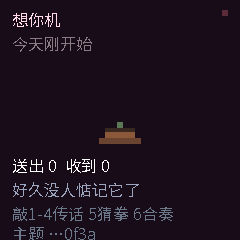
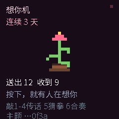

# 想你机 · Think of You

[](https://github.com/lispking/think-of-you/actions/workflows/test.yml)
[](LICENSE)

**两台小设备，一个按键，几种心情。**

按下这台，那台就会响、会亮、会用它自己的声音说出一句话。
没有文字输入，没有未读红点，没有「对方正在输入」——
只有两台设备之间，那一点点想念。

<p align="center">
  
  
</p>

## 玩法

按键只有一个，但「敲几下」已经够用：

| 敲 `function` 键 | 送出的 | 对方那台 |
| --- | --- | --- |
| 1 下 | 「有人在想你。」 | 敲 1 声把你的节奏敲回来，再念出来 |
| 2 下 | 「在忙，等下回你。」 | 敲 2 声 + 念出来 |
| 3 下 | 「吃饭了吗？」 | 敲 3 声 + 念出来 |
| 4 下 | 「晚安，好好睡。」 | 敲 4 声 + 念出来 |
| 5 下 | 发起一局猜拳 | 两边各敲 1/2/3 出石头 / 剪刀 / 布，各自算出同一个结果 |
| 6 下 | 发起合奏 | 两台从同一秒开始，一台奏主旋律、一台奏伴奏 |

敲多少下靠**间隔**分辨：相邻两下小于 450ms 算同一串，停手 700ms 才结算。
所以「慢慢地敲」和「连着敲」是两件事。

除了消息，还有两样不靠网络的东西：

- **同频心跳**：两台用同一个墙上时钟算节拍，指示灯一起脉动，两个房间一起呼吸。
- **想念会长大**：交换累积长成一株像素植物，放着不管会蔫，攒够了开花。

送出次数、收到次数、轮询游标、长势、连续天数、比分都会存档，重启后接着用。

## 快速开始

### 先看效果（桌面模拟器，零配置）

从 [LingClaw-SDK](https://github.com/LISTENAI/LingClaw-SDK) 下载模拟器，
打开本项目根目录下的 `think-of-you.lua`：

```sh
think-of-you.lua
```

点击预览画面后连着按空格键就是敲击（Mini 预设把空格映射到 `function`）：
敲一下停手是「想你」，敲三下停手是「吃饭了吗」。
模拟器走的是电脑的真实网络，`on_http_response` 是真的 ntfy 请求。

### 烧到真机

需要 [Android Platform Tools](https://developer.android.com/tools/releases/platform-tools)，
以及一台支持 ADB 调试的 Mini（固件 3.0.2 及以上）。

```sh
./flash.sh --topic lingclaw-think-换成一段难猜的字符串
```

一条命令把**所有已连接设备**都烧上同一份源码，并逐台回读校验。

## 配对两台设备

1. **换掉主题名。** ntfy 的主题名就是密码，公开主题任何人都能订阅，
   所以要用一段难猜的字符串。两台填**同一个**。
2. **两台跑同一份脚本。** 不需要区分身份：自己的回显靠每条消息自带的随机 token 认出来。
3. **一条命令烧两台：**

   ```sh
   ./flash.sh --topic lingclaw-think-换成随机串
   ```

   之后重烧直接 `./flash.sh` 即可，主题名会记在 `device-flash.topic`（不进版本库）。
4. **手工烧也行**，两台烧同一份：

   ```sh
   adb push think-of-you.lua /miniapp/think-of-you.lua
   ```

   上传后设备立即运行。两台屏幕底部「主题 …xxxx」一致即为同题。
5. **想改回设备上正在跑的版本：**

   ```sh
   adb pull /miniapp/miniapp.lua ./device-app.lua
   ```

> 源码只存在设备内存里，**重启后要重新烧录**；`storage` 里的数据会保留。

## 配置

脚本顶部集中了所有可调项：

| 变量 | 含义 | 默认 |
| --- | --- | --- |
| `TOPIC` | ntfy 主题，**两台必须相同**，务必改掉 | 占位值，必须替换 |
| `WORDS` | 敲 1-4 下送出的短语（`say` 是对端念的，`hint` 是本机标签） | 4 句中文 |
| `POLL_MS` / `POLL_BUSY_MS` | 空闲 / 密集（对局、合奏、刚有来往）的轮询间隔 | `10000` / `2000` |
| `ACTIVE_WINDOW_MS` | 收到消息后保持密集轮询多久 | `15000` |
| `SEND_COOLDOWN_MS` | 两次发送之间的最小间隔 | `1200` |
| `TTS_COOLDOWN_MS` | 两次播报之间的最小间隔 | `2000` |
| `TAP_GAP_MS` / `TAP_SETTLE_MS` | 同一串手势的最大间隔 / 结算前的静默 | `450` / `700` |
| `BEAT_MS` | 心灯节拍长度 | `2000` |
| `GROW_DECAY_SEC` / `GROW_FEED_SENT` / `GROW_FEED_GOT` / `GROW_BLOOM` | 长势回落速度 / 送出喂多少 / 收到喂多少 / 开花线 | `1800` / `8` / `14` / `90` |
| `STEP_MS` / `SONG_LEAD_SEC` | 合奏每槽时长 / 开场前留的传播时间 | `600` / `15` |
| `MATCH_TIMEOUT_MS` | 一局猜拳最多等多久 | `60000` |

## 项目结构

```
think-of-you.lua   应用本体。设备端只能跑一个 .lua（没有 require / io），所以是单文件
flash.sh           一键烧两台：注入主题、按 transport_id 分发、烧完回读校验
assets/            README 用的界面截图（模拟器渲染）
docs/              协议、设计取舍、硬件限制、验证方法
tests/             打桩契约测试 + 真实 API 探针
.github/           CI 与 issue / PR 模板
```

## 文档

| 文档 | 内容 |
| --- | --- |
| [docs/protocol.md](docs/protocol.md) | 消息格式、自过滤、游标、轮询节奏 |
| [docs/design.md](docs/design.md) | 每个设计决定背后的硬约束与代价 |
| [docs/hardware.md](docs/hardware.md) | 设备能力、运行环境限制、因此做不了什么 |
| [docs/testing.md](docs/testing.md) | 三层验证方法，以及 README 截图的复现方式 |
| [CONTRIBUTING.md](CONTRIBUTING.md) | 环境、怎么跑测试、怎么烧录、提交规范 |
| [CHANGELOG.md](CHANGELOG.md) | 变更记录 |

## 开发与验证

不需要编译模拟器，用一个标准 Lua 就能跑完整套契约测试：

```sh
lua tests/mock_think.lua
# == 结果: 11853 通过, 0 失败 ==
```

替身按设备文档逐项校验参数（绘制额度、HTTP 额度、播报并发、存档上限等），越界即报错，
所以它同时是功能测试和契约测试。详细说明见 [docs/testing.md](docs/testing.md)。

## 已知限制

- **公共主题没有隐私。** 消息内容对任何知道主题名的人可见；要彻底私有化可以
  自建 [ntfy 服务端](https://docs.ntfy.sh/install/)，或在请求上加 `Authorization` 头。
- **心灯与合奏要求设备已校时。** `clock.now()` 未校时时返回 `nil`，心灯会退化成
  本机节奏，合奏会拒绝发起。
- **麦克风用不上。** 硬件有，但 Lua 侧没有音频输入接口。
- **源码不在闪存里。** 设备重启后要重新烧录。
- **两台设备的 ADB 序列号可能相同**，必须用 `transport_id` 区分（`flash.sh` 已处理）。

更多限制与原因见 [docs/hardware.md](docs/hardware.md)。

## 贡献

欢迎 issue 与 PR，先看 [CONTRIBUTING.md](CONTRIBUTING.md)。

## 许可证

本项目采用 [MIT](LICENSE) 许可证。
